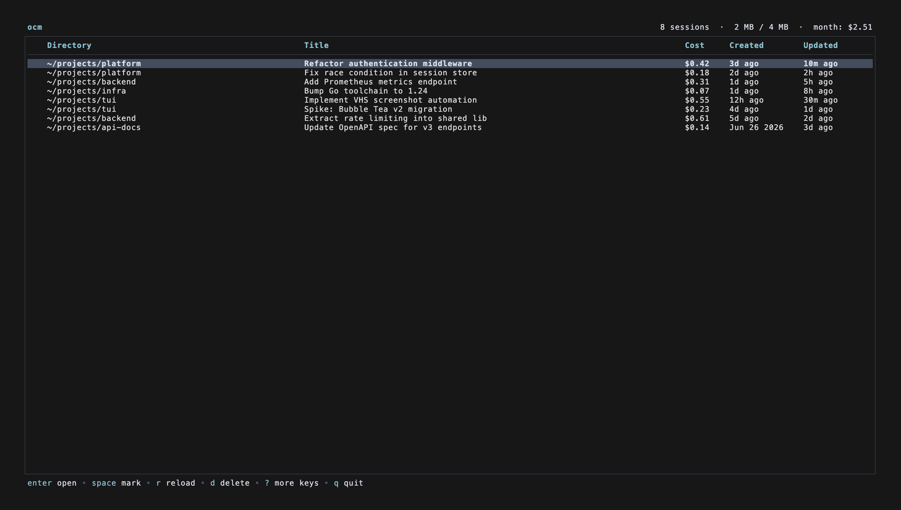

# ocm

Interactive TUI for browsing and managing your OpenCode sessions. Lists all sessions from the local OpenCode database with cost, directory, and timestamps — and lets you open, delete, and clean up directly from the table.



## Requirements

OpenCode V1 or V2 installed and at least one session created. OCM asks the
`opencode` executable on your `PATH` for its storage locations using
`opencode debug paths`. The usual database path is:

```
~/.local/share/opencode/opencode.db
```

Custom `XDG_DATA_HOME`, `OPENCODE_DB`, and release-channel paths are discovered
automatically. Relative `OPENCODE_DB` overrides resolve under OpenCode's data
directory. In-memory databases and remote servers are not supported.

OCM reads `session_v2` whenever that table exists, including migrated V1
sessions. Older databases use `session`. Legacy rows left behind by V2 are not
merged into the list, so deleted sessions stay deleted. Untitled V2 sessions
appear as “Untitled session.” Browsing opens the database read-only and never
runs migrations.

Resume and delete use the same executable and database that OCM reads. All V2
actions use `--standalone`, including those using the default database path, to
avoid connecting to a background service using another database. This starts
a private server for the action instead of reusing the background service.

## Install

```bash
brew install kimoofey/tap/ocm
```

Or build from source:

```bash
go install github.com/kimoofey/tui/cmd/ocm@latest
```

## Usage


```
ocm [OPTIONS]

  --sessions    Show only top-level sessions, hide subagent workflows
  --cost-period Show period cost in title bar: week|month|year
  --version     Print version and exit
```

## What the table shows

| Column    | Description                                                  |
| --------- | ------------------------------------------------------------ |
| (mark)    | `●` when selected for bulk action                            |
| Directory | Working directory of the session (home dir shortened to `~`) |
| Title     | Session title as set by OpenCode                             |
| Cost      | Accumulated LLM cost                                         |
| Created   | Session creation time                                        |
| Updated   | Last activity time                                           |

`--cost-period` uses the active schema's recorded costs. V2 period totals include
assistant messages and compaction usage, excluding history copied into forks.
The period total includes subagent usage even with `--sessions`. Deleting a
session removes its cost history from these totals.

## Keybindings

| Key               | Action                                                                  |
| ----------------- | ----------------------------------------------------------------------- |
| `↑/k` `↓/j`       | Navigate                                                                |
| `PgUp/b` `PgDn/f` | Page up / down                                                          |
| `Space`           | Mark / unmark row for bulk action                                       |
| `Enter`           | Open session in OpenCode                                                |
| `r`               | Reload sessions and stats from the database                             |
| `d`               | Delete session (or all marked) — press `d` again to confirm             |
| `v`               | Vacuum database — reclaims free pages (skipped if < 1 MB reclaimable)   |
| `p`               | Prune orphaned diff files — removes leftover files for deleted sessions |
| `esc`             | Clear marks / close help / cancel pending action                        |
| `?`               | Toggle full help                                                        |
| `q`               | Quit                                                                    |

## Database maintenance

**Vacuum** runs SQLite's `VACUUM` command to compact the database file and reclaim space freed by deleted sessions. Only offered when there is at least 1 MB to reclaim.

**Prune orphans** deletes `storage/session_diff` JSON files in OpenCode's data
directory whose session no longer exists in the active session table. Pruning
is available only for the default `opencode.db` in that directory. It is
disabled for custom and channel-specific database files because legacy diff
files do not identify which database owns them. Missing legacy diff directories
require no cleanup.

### History storage (implementation preview)

History is disabled by default. The storage/collection milestone is implemented;
Guarded V2 deletion is implemented; History navigation and archive-only startup
remain pending in plan 004. The enabled feature is not yet release-ready.

To opt in, add this to `$XDG_CONFIG_HOME/ocm/config.yaml` (or
`~/.config/ocm/config.yaml` when XDG_CONFIG_HOME is empty or unset) and restart:

```yaml
history:
  enabled: true
```

Unknown configuration fields, malformed YAML and multiple documents are errors.
Help/version bypass configuration. Mock builds use their deterministic browser data
and never read user history configuration or archives.

Enabled startup and successful explicit browser reloads request background
collection. Requests coalesce, sessions are captured sequentially, and there is no
periodic collection. Browsing/resume remain available during capture. Collection
errors appear in the browser status. Enabled V2 deletion captures the target and
all known descendants before invoking the existing native command.
Disabled operation keeps the existing deletion and browsing behavior and performs
no history extraction, file access, locking or directory creation.

The private archive is `$XDG_DATA_HOME/ocm/history.sqlite3` (fallback
`~/.local/share/ocm/history.sqlite3`). It stores native accounting identities,
recorded USD costs, provider/model names, five independent optional token counters,
usage timestamps and capture/quality status. It stores no conversation titles,
conversation paths, prompts, responses, tool arguments or raw JSON. One canonical
source database path and authoritative schema family bind on the first successful
capture. A different path/schema blocks collection, preserving saved usage; return
to the original source or disable history accepting capture gaps. Same-path source
replacement/ID reuse and arbitrary source copies are not reliably detected.
A lifetime advisory lock permits only one enabled instance per archive.

Accounting uses approximate recorded USD, summed before formatting, and UTC days.
Missing/invalid fields stay unknown; recorded zero remains zero. Missing timestamps
are unbucketed in all-time totals and excluded from dated ranges. V1 includes
recorded assistant usage, including copied fork messages:
“Approximate: V1 forked sessions may include copied usage.” V2 retains fork exclusion
and compaction-event accounting. Source-only `--cost-period` behavior is unchanged.

Repeated captures are idempotent. Stable identities permit corrections, including
lower costs and changed day/model attribution. If any old identity disappears or a
known accounting field becomes unknown, the entire previous session snapshot is
retained as stale; other sessions continue collecting. This conservative rule can
stop tracking later usage after pruning or compaction changes identities. Missing
sessions and source/native maintenance never remove archive rows. Coverage includes
only successfully observed usage; external deletion before capture is unrecoverable.


With history enabled, a fresh complete capture of every known session in a native
V2 deletion tree must commit before that tree's native action can start. Missing
sessions, uncertain accounting eligibility, stale retention, binding mismatch,
archive errors or cancellation block the action. Already committed captures remain
saved if a later capture or native action fails. Collection yields to queued
deletion between sessions; capture, native completion and the authoritative browser
reload share the same serializer. Successful actions request another collection.

Bulk selection collapses selected descendants beneath selected ancestors. Reported
counts are successful native session trees, not the number of all removed sessions.
Independent trees can continue after another fails; a failed ancestor never triggers
an automatic retry of its selected descendants. The browser reloads once after the
batch, even on failure, and keeps surviving marks/cursor on failed actions.
Vacuum and prune remain separate maintenance operations.

Guarded deletion currently supports the `session_v2` parent/descendant layout,
including children hidden by `--sessions`; forks alone are not children. Cycles are
rejected. V1 collection remains supported, but enabled V1 deletion is unavailable:
its native child recursion depends on the CLI's current project, which the database
binding cannot identify safely. Unsupported scope leaves browsing/resume available
and reports the restriction. Disabling history restores existing native behavior,
accepting capture gaps.

V2 control messages (`synthetic`, `idle`, agent/model/location switches, skill,
shell and compaction projections) are recognized explicitly. Compaction spend is
counted from usage events, avoiding duplicate projection costs. Unknown or malformed
roles/types still reject the whole session capture; errors identify the schema and
native session/message IDs without printing conversation payloads.

The guarantee covers only observations committed before an OCM-requested deletion.
Native writers, children created after discovery, disabled OCM and separate archives
can race capture/deletion. There is no atomic source/archive/native transaction or
recovery journal. Killing OCM can leave a native deletion process running: let it
finish before retrying. Startup never retries destructive actions automatically.
Usage removed before capture cannot be recovered by rerunning collection.
